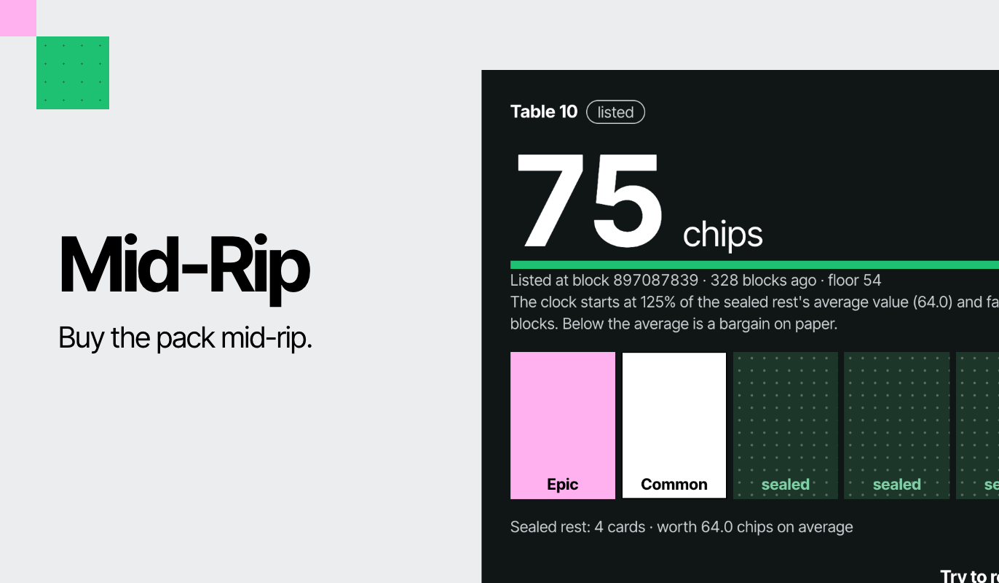
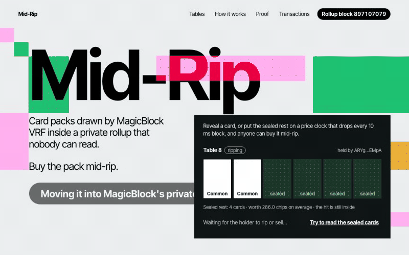

# Mid-Rip



Buy the pack mid-rip. Mid-Rip is a card-pack game on Solana where the unopened rest of a pack can change hands while someone is opening it.

It needs MagicBlock because MagicBlock VRF draws each pack into an account on a private Ephemeral Rollup that nobody can read, the developer included, and the sealed rest sells on a price clock that drops every 10 ms rollup block.

Live at https://midrip.vercel.app (Solana devnet, play chips, no wallet needed).



### Try it in 30 seconds
1. Open the link. The page makes a wallet that lives in your browser, and a labelled demo bot starts opening packs at the other tables.
2. Press Get 2,000 play chips, then Open a pack on a free table.
3. Reveal a card or two, then press Sell the sealed rest and watch the price fall block by block. The bot buys once the price drops below the rest's average value. You can also buy the bot's sealed rest yourself.
4. When a pack ends, press Verify this pack. On a pack that still has sealed cards, press Try to read the sealed cards and the rollup returns nothing.
5. Press Move my cards to my wallet: your cards are minted as SPL tokens in your wallet on Solana.

## How it works

A pack has six cards: five base cards (Common 80%, Uncommon 20%) and one guaranteed hit (Rare 75%, Epic 22%, Legendary 3%) at a position nobody knows.

1. `open_pack` charges the pack price and asks MagicBlock VRF for randomness before anything is shown. The VRF callback draws all six cards into the table's sealed account and posts only a commitment, `sha256(randomness, cards, pack nonce)`, on the public table account.
2. Each `reveal` moves one card from the sealed account to the public table. At any point the holder can `list_rest`: the program works out the average value of the cards still sealed from public facts only (cards left, and whether the hit is still inside), and starts a clock at 125% of that value that falls to 85% over 1,500 rollup blocks.
3. `buy_rest` pays the holder the clock price for the current block and hands over the pack. The buyer keeps ripping. Cards already revealed stay with whoever revealed them.
4. After the last card the randomness becomes public, the table and players commit to Solana, and anyone can recompute every card from the VRF output and check it against the commitment.
5. Your cards are yours. `withdraw_cards` takes them out of play on the rollup, the next settle commits that to Solana, and `claim_cards` mints them as SPL tokens (one mint per rarity, decimals 0) into your wallet. In the app that is one button, Move my cards to my wallet.

Packs are priced to pay back 97% on average (328 chips for an average value of 318); across our 400 test packs they paid back 93.8% (95% interval 83.3% to 105.4%). Cards sell back at their full table value.

## How it uses MagicBlock

| MagicBlock feature | What it does here | Code |
|---|---|---|
| Private Ephemeral Rollup (TEE) | Holds each pack's drawn cards in an account with a private permission and no members, so no wallet can read it | [`create_sealed_permission`](programs/midrip/src/lib.rs), [setup](app/scripts/setup.mjs) |
| VRF inside the rollup | Draws the pack before any sale or reveal; the callback checks MagicBlock's VRF signer | [`open_pack`, `callback_draw`](programs/midrip/src/lib.rs), [draw](programs/midrip/src/logic.rs) |
| 10 ms rollup blocks, free transactions | Every reveal, listing and purchase is its own transaction; the clock price is a function of the rollup block | [`list_rest`, `buy_rest`](programs/midrip/src/lib.rs), [clock price](programs/midrip/src/logic.rs) |
| Commit back to Solana | Finished packs and player balances settle to Solana with `MagicIntentBundleBuilder` | [`settle`, `settle_players`](programs/midrip/src/lib.rs) |
| Delegation | Player accounts and tables are delegated to the private rollup's validator | [`delegate_player`, `delegate_table`](programs/midrip/src/lib.rs) |
| Owned cards on Solana | Withdrawn cards, once committed, are minted as SPL tokens to the player's wallet; a claim record stops double minting | [`withdraw_cards`, `claim_cards`](programs/midrip/src/lib.rs) |

### The core of it, from `programs/midrip/src/lib.rs`

The VRF callback writes the pack only into the private account and publishes only the commitment:

```rust
pub fn callback_draw(ctx: Context<CallbackDraw>, randomness: [u8; 32]) -> Result<()> {
    let (tiers, hit_pos) = draw_pack(&randomness, &config.base_weights, &config.hit_weights);
    let sealed = &mut ctx.accounts.sealed;       // private permission, no members
    sealed.tiers = tiers;
    sealed.hit_pos = hit_pos;
    sealed.randomness = randomness;
    table.commitment = commitment(&randomness, &tiers, table.nonce); // public
    table.state = TableState::Ripping as u8;
    Ok(())
}
```

Only MagicBlock's VRF program can call it: the signer is checked against this program's scoped VRF identity, computed at compile time.

```rust
pub const VRF_CALLBACK_IDENTITY: Pubkey =
    Pubkey::new_from_array(ephemeral_rollups_sdk::vrf::consts::scoped_vrf_identity_const(&crate::ID).0);
#[account(address = VRF_CALLBACK_IDENTITY)]
pub vrf_program_identity: Signer<'info>,
```

The sealed account is made private on the rollup with an empty member list:

```rust
CreateEphemeralPermissionCpi { /* sealed account pays and is permissioned */
    args: EphemeralMembersArgs { is_private: true, members: vec![] }, .. }
.invoke_signed(&[seeds])?;
```

The clock price depends only on the rollup block (`programs/midrip/src/logic.rs`):

```rust
pub fn clock_price(start: u64, floor: u64, list_slot: u64, duration_slots: u64, slot: u64) -> u64 {
    let elapsed = slot - list_slot;
    if elapsed >= duration_slots { return floor; }
    start - ((start - floor) as u128 * elapsed as u128 / duration_slots as u128) as u64
}
```

The browser talks to the private rollup with a token signed by the in-browser wallet ([`chain.ts`](app/src/lib/chain.ts)); the verifier mirrors the on-chain draw exactly ([`packmath.ts`](app/src/lib/packmath.ts)).

## Evidence

Evidence, stated plainly: no real users yet; it was built for this hackathon. Instead: test transactions from wallets we control on Solana devnet and MagicBlock's private rollup, and our own break test of the claim that nobody can read a sealed pack. Each one reruns from the repo with one command.

> Claim: every Mid-Rip pack can be checked: all 6 cards recomputed from the VRF output match the cards revealed and the commitment posted before the first reveal.
> Evidence type: Test transactions from wallets we control, not real users.
> Data: 400 packs on Solana devnet and MagicBlock devnet-tee, 27 Nov 2026, program `DAthUNW8m79QheY2oNPq42ab99hCcavp1BVXDrmAHgYM`, records in [evidence/packs-run1.json](evidence/packs-run1.json) and [evidence/packs-run2.json](evidence/packs-run2.json).
> Result: 400 of 400 packs verify (95% interval 99.0% to 100.0%).
> Rerun: `cd app && npm install && PACKS=300 node scripts/evidence.mjs`. Limits: devnet and play chips; MagicBlock's VRF oracle and the TEE operator are trusted.

> Claim: the cards follow the published odds.
> Evidence type: Test transactions from wallets we control, not real users.
> Data: the same 400 packs: 2,000 base cards and 400 hit cards.
> Result: base cards 1,599 Common and 401 Uncommon against 1,600 and 400 expected (chi-squared p = 0.955); hit cards 293 Rare, 98 Epic, 9 Legendary against 300, 88 and 12 expected (p = 0.359).
> Rerun: as above. Limits: 400 packs is a small sample for a 3% tier.

> Claim: packs pay back about 97% of their price.
> Evidence type: Test transactions from wallets we control, not real users.
> Data: the same 400 packs. Baseline: Bitquery measured that Collector Crypt players got back 94.2% of what they spent (Dec 2025 to Jul 2026).
> Result: 93.8% (95% interval 83.3% to 105.4%). The first run of 100 packs alone gave 76.6% (68.7% to 84.9%) because it drew no Legendary; the second run of 300 gave 99.5%. We do not claim a higher payout than Collector Crypt: our interval's low end is below 94.2%.
> Rerun: as above. Limits: one Legendary is worth 2,500 chips, so a few hundred packs leave a wide interval.

> Claim: a reveal on the rollup comes back in about a sixth of a second.
> Evidence type: Test transactions from wallets we control, not real users.
> Data: the same 400 packs: 400 VRF draws and 2,400 reveals, timed by the client in India against devnet-tee.
> Result: VRF draw median 227 ms (90th percentile 261 ms); reveal median 167 ms (90th percentile 193 ms). These are client round trips, not block times.
> Rerun: as above.

> Claim: nobody can read a sealed pack.
> Evidence type: Our own break test (we tried to make it fail).
> What we tried: reading the sealed account as a stranger and as the pack's own opener (both got nothing); listing the transactions of the table, the sealed account and the program (transactions that touch the sealed account are not listed to anyone); searching 170 recent transactions on the VRF queue, the VRF program and the SlotHashes sysvar for the callback that carries the randomness (not found).
> What broke and what we fixed: the first VRF callbacks never arrived because SDK 0.18's callback macro runs out of compute; we check the VRF signer against a compile-time constant instead.
> Rerun: `cd app && node scripts/e2e.mjs`. Limits: any transaction can be fetched by someone who already knows its signature.

Limits, in numbers: zero real users; 400 test packs; payout interval 83.3% to 105.4%. The next real test is a few thousand packs from many wallets, where a payout interval entirely above 94.2% would let us claim a better deal than Collector Crypt.

## Check it yourself

- Program on Solana Explorer: [DAthUNW8…](https://explorer.solana.com/address/DAthUNW8m79QheY2oNPq42ab99hCcavp1BVXDrmAHgYM?cluster=devnet)
- Card mints (Common, Uncommon, Rare, Epic, Legendary): [8uWJ…](https://explorer.solana.com/address/8uWJcSJQE3VgTsPZA1wPfkBAHHYXJy3GuMtQmnmCAK1T?cluster=devnet), [AAPn…](https://explorer.solana.com/address/AAPnuod7Qgr5quTyGzbVuguxtNYKvRQ1BE9sDkeyhzRa?cluster=devnet), [AGoi…](https://explorer.solana.com/address/AGoiKd5rad7t1CVYCc6kNTfa6FWucbmYETJhChUEH1Z2?cluster=devnet), [FDu2…](https://explorer.solana.com/address/FDu2RZRpvCt4on6uYCj5ZpHYmWdECMnCBQBc9WWCUUqw?cluster=devnet), [AMdM…](https://explorer.solana.com/address/AMdMqwh4YmHANUur4rq1kD2LyqdhdJoLVSMhj32dkJby?cluster=devnet)
- Every pack in the evidence runs with its randomness and commitment: [evidence/packs-run2.json](evidence/packs-run2.json)
- Any finished pack on the live site: press Verify this pack.

## What doesn't work yet

- Devnet only, with play chips. No real money moves. Cards in play are counts in each player's account; moved to a wallet they become SPL tokens with no metadata or images yet.
- The demo bot runs in each visitor's browser so there is always someone to trade with. It is labelled everywhere it acts.
- MagicBlock allows 10 plain commits per delegation, so a table commits itself to Solana for its first 9 packs; after that only player accounts are committed.
- Trust: MagicBlock's VRF oracle and the operator of the TEE validator could see a pack's randomness. Our scripts check the endpoint's Intel TDX attestation with MagicBlock's SDK (which has an open issue about what that check authenticates, ephemeral-rollups-sdk #158); the browser app does not run that check yet.

## Run it

```bash
# program (Anchor 1.0.2 crates, ephemeral-rollups-sdk 0.18.0)
cargo build-sbf && cargo test -p midrip --lib
# web app
cd app && npm install && npm run dev
# end-to-end on devnet, including the privacy checks
cd app && node scripts/e2e.mjs
```

The scripts need a funded devnet keypair at `~/.config/solana/id.json` (the admin for setup) and a funded devnet keypair for the relayer that pays new players' setup, passed as `RELAYER_KEYPAIR=/path/to/keypair.json` (end-to-end and evidence runs) or as `RELAYER_SECRET` holding its JSON secret key (web app).
